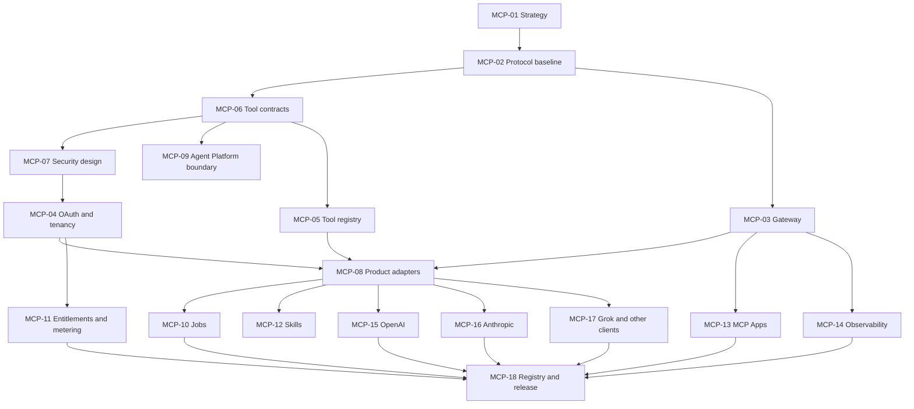

# Tinlance Extensions — Master Delivery Roadmap

**Document status:** Accepted programme roadmap baseline; implementation and feasibility remain unverified
**Owner:** Tinlance Limited
**Repository:** https://github.com/LloydCoder/tinlance-extensions
**Last updated:** 2026-11-07
**Consolidated programme plan:** [FINAL-PHASE-PLAN.md](FINAL-PHASE-PLAN.md) (accepted controlling programme index)

> This roadmap is a controlled delivery plan, not a status report. A phase or work package is complete only when its evidence, acceptance criteria and review record exist. A green build alone does not prove product readiness.

## 1. Delivery strategy

Tinlance Extensions will be delivered through three programme milestones, with security, privacy, testing, documentation and operational readiness as continuous gates.

- **Milestone A — Governed foundation:** repository, architecture, toolchain, CI, identity, policy and core platform contracts.
- **Milestone B — Commercial beta:** initial browser products, product adapters, MCP beta, accounts, entitlements, usage controls and limited distribution.
- **Milestone C — Enterprise production:** browser/client compatibility, independent assurance, resilience, enterprise controls, directory/store approvals and operational acceptance.

The project retains the 25-phase ecosystem roadmap. The MCP programme is a dedicated 18-work-package workstream integrated into those phases. It is not a parallel ungoverned server project.

## 2. Programme-wide release principles

1. No planned product is advertised as available.
2. No MCP tool is published before its backing service and permission model are ready.
3. No consequential browser action is authorized by MCP alone; the Tinlance Agent Platform remains authoritative.
4. No public directory submission is treated as approved until the platform confirms approval.
5. No browser support is claimed without a tested browser/version record.
6. Security and privacy are release gates, not final-phase tasks.
7. Every work package has an owner, dependencies, acceptance evidence and status.
8. Paid infrastructure or vendor commitments require explicit budget approval.
9. Use pull requests, CI evidence and reviewable changes; avoid undocumented direct-to-production edits.
10. The project status must distinguish proposed, in progress, implemented, verified, released and deprecated.

## 2A. Phase 0 — Repository foundation

**Purpose:** establish the minimum governed, testable repository foundation before product implementation.

Scope:
- Repository conventions, ignore rules, security and contribution policies.
- Least-privilege CI workflow with immutable action pins.
- Dependency-free repository validation and regression tests.
- ADRs for repository governance and the proposed MCP protocol baseline.
- Accurate README, architecture, roadmap and implementation-status links.
- Preserve the existing Apache-2.0 license pending a separate legal/IP decision.
- No paid infrastructure, product runtime, browser package, or MCP gateway in this phase.

**Phase 0 exit:** foundation files exist; repository validation and tests pass in GitHub Actions; architecture and roadmap are reconciled; final change is merged to main. This is repository readiness, not application readiness.

## 3. The 25-phase ecosystem roadmap

### Foundation — Milestone A

| Phase | Scope | Exit evidence |
|---:|---|---|
| 01 | Repository and baseline forensic audit | Default branch, files, workflows, dependencies, current product state, risks and gaps documented |
| 02 | Product requirements and portfolio specification | Product briefs, user personas, use cases, permission needs, pricing assumptions and release order |
| 03 | Master architecture and ADR approval | Approved architecture, boundaries, dependency graph, security model and ADR set |
| 04 | Monorepo and developer platform | Reproducible workspace, pinned toolchain, local setup, scripts and clean checkout build |
| 05 | CI/CD and repository governance | Required checks, branch protection, dependency automation, release permissions and provenance controls |
| 06 | Design system and UX foundation | Tokens, components, accessibility baseline, extension patterns and web portal design |
| 07 | Browser SDK and compatibility foundation | Browser adapters, messaging, storage, permissions and compatibility test harness |
| 08 | Identity, authentication and tenancy | Account model, sessions, organization model, tenant isolation and authorization primitives |
| 09 | Backend and data architecture | Service ownership, schemas, migrations, API contracts, queues and data lifecycle |
| 10 | Security and privacy control plane | Threat models, policies, consent, audit, secret handling, retention and security gates |

### Phase 01 — Repository and baseline forensic audit

**Purpose:** establish a dated, commit-specific factual baseline and remediation register for the repository, rather than inferring implementation from product plans.

Scope:
- Inspect default branch contents, history, repository settings available to the audit, license, package manifests, workflows, tests, releases, and current pull requests.
- Record verified facts separately from unavailable/unknown administrative settings.
- Inventory absent runtime components and identify security, privacy, supply-chain, quality, and operational risks.
- Reconcile README, architecture, roadmap, ADRs and actual repository state.
- Add reproducible repository validation so the baseline itself remains regression-tested.

**Phase 01 exit:** baseline report is committed; all accessible evidence is cited or identified; unknowns are explicit; critical/high foundation blockers have an owner and treatment; CI is green and the change is merged. Administrative settings inaccessible to the integration remain owner-verification items and must not be falsely marked complete.

### Phase 02 — Product requirements and portfolio specification

**Working baseline:** [PHASE-02-PRODUCT-REQUIREMENTS.md](PHASE-02-PRODUCT-REQUIREMENTS.md)

The Phase 02 document defines product briefs for all 26 catalogue entries, MVP boundaries, permission/data assumptions, security acceptance criteria, shared dependencies, commercial hypotheses, prioritization scores and validation gates. The documentary baseline is reconciled; substantive evidence remains open.

**Current status:** documentary requirements baseline reconciled; Phase 02 remains open because customer discovery, product-owner sign-offs, legal/provider reviews, product-specific threat-model approvals and commercial evidence remain outstanding. ADRs 0003–0014 are accepted; A1 passed through the isolated workspace spike. A2 remains partial: PR #30 proves Chromium MV3 popup/runtime and service-worker restart and successful Safari Xcode packaging/project validation; PR #32 proves Chromium keyboard-shortcut user invocation grants temporary `activeTab` and permits `scripting.executeScript` against a loopback fixture; PR #34 proves Firefox keyboard-shortcut `activeTab`/`scripting` runtime against a loopback fixture; PR #38 adds Edge Stable, Brave Stable and Opera Stable headed runtime checks. Safari runtime enablement/execution, signing/notarization and store validation remain open. A3 has PostgreSQL RLS/idempotency/outbox, worker lease/recovery/fencing and concurrent claim evidence (PRs #28/#40/#42), plus a PostgreSQL-backed HTTP repository adapter with real PostgreSQL 16 HTTP integration and pooled-session reset proof (PR #44; exact-head and post-merge checks green). A3 remains partial pending production identity/token and database credential provisioning, application worker lifecycle/crash recovery, external outbox delivery/consumer idempotency, cancellation and operational recovery; A4–A7 remain open. See [Phase 02 Evidence and Architecture Feasibility Review](PHASE-02-EVIDENCE-AND-FEASIBILITY-REVIEW.md).

Phase 02 must:
- secure a named owner and reviewed brief for every catalogue product;
- validate target-user jobs and commercial assumptions with structured customer discovery;
- review least-privilege permissions, data classes, retention and deletion per product;
- produce product-specific threat models for security-sensitive and agent-governed products;
- resolve shared-service dependencies and authority boundaries;
- record technical spikes and browser/API compatibility unknowns;
- approve the ranked portfolio and any proposed change to the initial seven-product release order.

**Phase 02 exit:** all 26 briefs have dated owner/reviewer dispositions; priority-segment discovery and commercial evidence are recorded; high-risk product gates have owners and treatments; permission/data and security reviews are approved; dependency graph and ranked release plan are signed off; residual risks are accepted and the decision owner records go/no-go. The 2026-11-05 evidence review records these substantive gates as open.

**Milestone A exit:** ADRs 0003–0014 are accepted; A1 passes; A2 remains partial after PRs #30/#32/#34/#36/#38 provide Chromium/Firefox/Edge/Brave/Opera runtime and Safari Xcode compile/package evidence; Safari runtime enablement/execution, signing/notarization and store validation remain open. A3 is partial: PRs #28/#40/#42 provide PostgreSQL RLS, worker lease/recovery/concurrency and outbox lease/acknowledgement evidence; PR #44 adds a PostgreSQL-backed HTTP repository adapter and real PostgreSQL 16 HTTP integration with tenant isolation and pooled-session reset proof. Production identity/token and credential provisioning, application worker process recovery, external outbox delivery/consumer idempotency, cancellation and operational recovery remain open. A4–A7 and Phase 02 substantive evidence must pass before application implementation. MCP gateway work also requires executable MCP Gate 0 conformance and the Agent Platform no-bypass contract.

### Product and commercial beta — Milestone B

| Phase | Scope | Exit evidence |
|---:|---|---|
| 11 | Site Security Auditor | Working passive checks, evidence, confidence labels, safe URL handling and tests |
| 12 | Tinlyt Page Extractor | Reliable extraction, structured outputs, provenance and hostile-content handling |
| 13 | Aithyrex Guard | Local-first sensitive-data inspection, supported AI interfaces, clear user controls |
| 14 | Tinlyt Verify | Claim/evidence workflow, supporting and conflicting sources, uncertainty representation |
| 15 | Tinlyt Monitor | Scheduled monitoring, change detection, job lifecycle, notification and retention controls |
| 16 | FadeReach Prospect Capture | User-selected capture, normalization, lawful-use controls and export |
| 17 | Agent Browser Bridge | Paired browser, scoped actions, Agent Platform authorization, approval, audit and isolation |
| 18 | Commercial platform and customer management | Plans, entitlements, billing integration, usage metering, organization and account controls |
| 19 | Integrations and interoperability | Product adapters, external integrations, MCP beta, developer documentation and compatibility tests |

**Milestone B exit:** the initial portfolio works end-to-end in a controlled beta; MCP is available only for production-backed capabilities; entitlements, authorization, metering and audit are enforced server-side.

### Enterprise production — Milestone C

| Phase | Scope | Exit evidence |
|---:|---|---|
| 20 | Cross-browser compatibility and release engineering | Verified matrix, independent browser packages, store metadata, signing and rollback |
| 21 | Functional, integration and regression verification | Repeatable unit, contract, integration, E2E and cross-client results |
| 22 | Security and supply-chain assurance | Threat-model closure, security testing, SBOM/provenance, pen test and remediation evidence |
| 23 | Reliability and production operations | SLOs, alerting, backup/restore, disaster recovery, incident and capacity evidence |
| 24 | Documentation, legal and compliance readiness | Accurate policies, terms, privacy disclosures, support, admin and developer documentation |
| 25 | Production release and enterprise acceptance | Release approvals, directory/store status, customer acceptance and operational handover |

**Milestone C exit:** production and enterprise claims are supported by independent evidence, tested operational controls and actual platform/store approvals.

## 4. MCP programme — 18 work packages

The MCP workstream is integrated with the 25 phases. ADRs 0002 and 0012 accept the 2026-07-28 stateless Streamable HTTP baseline; executable MCP Gate 0 evidence and A5 remain outstanding. It must pass these gates before gateway implementation.

### Gate 0 — Design and authority before MCP implementation

| WP | Work package | Priority | Main dependencies | Acceptance evidence |
|---:|---|---|---|---|
| MCP-01 | MCP product strategy and distribution model | P0 | Phases 01–03 | Approved umbrella/specialist listing strategy, target clients, product scope, ownership and non-goals |
| MCP-02 | Protocol baseline and compatibility strategy | P0 | MCP-01 | Pinned stable specification revision, transport decision, capability matrix, SDK policy and compatibility fallback |
| MCP-06 | Tool contracts, schemas and annotations | P0 | MCP-01, MCP-02, product API contracts | Namespaced tool catalogue, schemas, output contracts, side-effect/risk annotations, version and deprecation rules |
| MCP-07 | Security and authorization enforcement design | P0 | Phases 08–10, MCP-02, MCP-06 | Reviewed OAuth/resource-server design, tenant isolation, scopes, approval matrix, threat model and security tests |
| MCP-09 | Agent Platform and Browser Bridge integration design | P0 | Phase 17 design, MCP-06, MCP-07 | Explicit authority boundary, typed request contract, approval lifecycle and no-bypass test plan |

**Gate 0 exit:** WP-01, WP-02, WP-06, WP-07 and WP-09 are approved. The project has a pinned protocol baseline, approved identity and authorization design, reviewed tool contracts and an explicit Agent Platform boundary. No production MCP gateway work begins before this gate.

### Gate 1 — Core MCP platform

| WP | Work package | Priority | Main dependencies | Acceptance evidence |
|---:|---|---|---|---|
| MCP-03 | MCP gateway and transport | P0 | Gate 0 | Remote endpoint, 2026-07-28 stateless Streamable HTTP, per-request header validation, origin validation, bounded requests and conformance tests |
| MCP-04 | OAuth, identity and tenant isolation implementation | P0 | Phase 08, MCP-07 | Login/consent, token validation, tenant-bound context, scopes, revocation and cross-tenant negative tests |
| MCP-05 | Tool and capability registry | P0 | MCP-06 | Registry API, lifecycle state, product ownership, definition fingerprints and reviewed change workflow |
| MCP-08 | Product adapter architecture and first adapters | P0 | Phases 11–16, MCP-03, MCP-05, MCP-06 | Typed adapters to at least one production-backed product, validation, redaction and adapter contract tests |

**Gate 1 exit:** a secured remote MCP service can expose a narrowly scoped, production-backed read-only capability to a test client, with tenant isolation, tool definition integrity, audit and conformance evidence.

### Gate 2 — Commercial and extended capabilities

| WP | Work package | Priority | Main dependencies | Acceptance evidence |
|---:|---|---|---|---|
| MCP-10 | Job management and long-running operations | P1 | Worker/data architecture, MCP-03 | Submit/status/cancel/result, idempotency, quotas, retries, expiry and interrupted-client recovery |
| MCP-11 | Metering, quotas and entitlements | P1 | Phase 18, MCP-04, MCP-05 | Server-side plan checks, per-tool usage, reconciliation, limits, overage behaviour and billing tests |
| MCP-12 | Skills distribution | P1 | Tool contracts, developer documentation | Versioned skills, supported-client matrix, safe instructions and published examples |
| MCP-13 | MCP Apps and interactive UI | P1 | Design system, MCP-02, security review | Optional interactive experience, CSP/origin/message validation, accessibility and client fallback |
| MCP-14 | Observability, audit and diagnostics | P1 | MCP-03 through MCP-11 | Correlated traces, redacted logs, audit explorer, per-tool health and alert/runbook evidence |

**Gate 2 exit:** asynchronous, commercial and interactive capabilities are independently feature-flagged, metered and tested. Clients without optional feature support retain a safe baseline experience.

### Gate 3 — Client compatibility and distribution

| WP | Work package | Priority | Main dependencies | Acceptance evidence |
|---:|---|---|---|---|
| MCP-15 | OpenAI submission and compatibility | P1 | Gates 1–2, distribution dossier | Real-client tests, reviewer credentials, positive/negative test cases, listing assets, privacy/policy declarations and submission status |
| MCP-16 | Anthropic submission and compatibility | P1 | Gates 1–2, distribution dossier | Claude client tests, connector requirements, tool annotations, test instructions, assets and submission status |
| MCP-17 | Grok and wider MCP client compatibility | P1 | Gates 1–2 | Grok custom connector test, documented provisioning, plus representative Codex/IDE/CLI client compatibility results |
| MCP-18 | Official registry, release and distribution automation | P1 | Stable endpoint, verified domain, release pipeline | Verified namespace, valid registry metadata, automated publish/rollback, version history and listing status tracking |

**Gate 3 exit:** each supported client has a tested compatibility record; each directory or registry has a separate, truthful submission/approval state; release automation is reproducible.

### MCP work package dependency overview

## 5. Initial product portfolio and release order

The canonical portfolio contains 26 distinct extension products. See [PRODUCT-CATALOGUE.md](PRODUCT-CATALOGUE.md) for approved product identities, boundaries, overlap decisions and status rules. Portfolio approval is not a commitment to implement or release all 26 simultaneously.

### Initial commercial release candidates

1. Site Security Auditor.
2. Tinlyt Page Extractor.
3. Aithyrex Guard.
4. Tinlyt Verify.
5. Tinlyt Monitor.
6. FadeReach Prospect Capture.
7. Agent Browser Bridge foundations, with public release only after Agent Platform governance gates pass.

### Later release groups

- Tinlyt Research (including Evidence and Source Inspector capabilities).
- Auctaryn Guard (new portfolio product; requirements and Auctaryn integration gate required).
- ThreatFade LinkShield, PrivacyGuard and DownloadGuard.
- FadeReach CompanyIntel, ContactIntel and Outreach Assistant; CRM is an integration, not a separate extension.
- Tinlance Workflow (including FormPilot capability) and Memory Vault Clipper.
- Developer utilities: JSON Explorer, StackDetect, WebDebugger (including API inspection) and AccessibilityCheck.
- SEO Inspector, SERP Intelligence, ShopIntel, Compliance Assistant and Authorized Security Testing Companion.

Do not expose a product or MCP tool as generally available while it is only a roadmap item, mock, fixture, prototype or unverified integration.

## 6. Distribution workstreams

### 6.1 AI client distribution

Track these as independent distribution targets:

| Target | Route | Release status vocabulary |
|---|---|---|
| ChatGPT | Custom MCP connection and public app directory submission | Not started / testing / submitted / approved / published / suspended |
| Claude | Remote MCP connector and Connectors Directory | Not started / testing / submitted / approved / published / suspended |
| Grok | Custom connector and enterprise provisioning | Not started / testing / provisioned / verified |
| Official MCP Registry | Verified namespace and server metadata | Not started / namespace verified / submitted / published / deprecated |
| Codex, Cursor, VS Code, Claude Code and other clients | Direct MCP compatibility | Not tested / smoke-tested / verified / unsupported |

A platform's custom connector support must not be represented as an official public marketplace listing. Record plan, region, account eligibility and client limitations at the time of testing.

### 6.2 Browser distribution

Separate release pipelines and submission checklists for Chrome Web Store, Firefox Add-ons, Edge Add-ons, Opera Add-ons and Safari. Every extension/browser combination must be marked supported only after packaging, permission, functional, update and review testing.

### 6.3 Tinlance-owned distribution assets

Before public submission, prepare and verify:
- Public product catalogue and accurate availability states.
- Product pages and installation instructions.
- Developer portal and MCP documentation.
- Privacy policy, terms, security disclosure and support contact.
- Verified company and domain identity.
- Brand assets, screenshots and store artwork.
- Status page, changelog and release notes.
- Reviewer accounts, test data and repeatable test scenarios.

## 7. Continuous workstreams

These are not deferred to Phase 22 or 24. They operate throughout all phases:

- **Security:** threat modelling, secure design review, SAST, dependency and secret scanning, DAST, penetration tests and remediation.
- **Privacy:** data mapping, consent, minimization, retention, deletion, export and subprocessor review.
- **Quality:** unit, contract, integration, E2E, browser compatibility, accessibility, performance and resilience.
- **Operations:** logs, metrics, traces, alerting, incident response, backups, restore, rollback and cost controls.
- **Documentation:** architecture, ADRs, runbooks, API/MCP docs, store disclosures and migration guides.
- **Commercial:** pricing validation, support process, entitlement accuracy, metering reconciliation and customer feedback.
- **Supply chain:** dependency pinning, lockfile integrity, SBOM, build provenance and release signing.

## 8. Definition of done

A work package is complete only when all applicable conditions are satisfied:

1. Scope and acceptance criteria are met.
2. Code/docs are committed through a reviewable change.
3. Automated tests pass in CI.
4. Security and privacy impacts are reviewed.
5. Contracts and documentation are updated.
6. Observability and failure handling are present where relevant.
7. Evidence links and test results are recorded.
8. No unresolved critical/high release blocker remains.
9. A named owner accepts operational responsibility.
10. Status is updated accurately.

### Enterprise production acceptance

- Fresh checkout installs, builds and tests reproducibly.
- Required CI checks are green on the release commit.
- Initial extensions work and can be released independently.
- Browser compatibility matrix is backed by test evidence.
- Safari has a distinct packaging and release process.
- MCP protocol, OAuth, tenancy, tool registry and client compatibility are verified.
- No unresolved critical/high security issues.
- Tool changes are versioned and security-reviewed.
- Consequential actions require Agent Platform authorization and approvals.
- Usage metering, quotas and entitlement enforcement are tested.
- Privacy disclosures, consent, retention, export and deletion are tested.
- Organization management, roles, audit and enterprise controls work as advertised.
- Backup/restore, rollback, incident response and SLOs are demonstrated.
- Accessibility target is WCAG 2.2 AA for owned web experiences, with documented exceptions and manual review.
- Directory and browser-store approval states are accurately represented.
- Support, vulnerability disclosure and release/update processes are operational.

## 9. Status tracking template

Use this table in project tracking; do not mark a package complete without evidence.

| ID | Status | Owner | Dependencies | Evidence / PR / test run | Blockers |
|---|---|---|---|---|---|
| MCP-01 | Not started | TBD | Phase 01–03 | TBD | TBD |
| MCP-02 | Not started | TBD | MCP-01 | TBD | TBD |
| MCP-03 | Not started | TBD | Gate 0 | TBD | TBD |
| MCP-04 | Not started | TBD | MCP-07, Phase 08 | TBD | TBD |
| MCP-05 | Not started | TBD | MCP-06 | TBD | TBD |
| MCP-06 | Not started | TBD | MCP-01, MCP-02 | TBD | TBD |
| MCP-07 | Not started | TBD | Phase 08–10 | TBD | TBD |
| MCP-08 | Not started | TBD | MCP-03, MCP-05, MCP-06 | TBD | TBD |
| MCP-09 | Not started | TBD | MCP-06, MCP-07, Phase 17 | TBD | TBD |
| MCP-10 | Not started | TBD | Worker architecture | TBD | TBD |
| MCP-11 | Not started | TBD | Phase 18, MCP-04 | TBD | TBD |
| MCP-12 | Not started | TBD | MCP-06 | TBD | TBD |
| MCP-13 | Not started | TBD | MCP-02, design/security | TBD | TBD |
| MCP-14 | Not started | TBD | MCP-03–11 | TBD | TBD |
| MCP-15 | Not started | TBD | Gate 1–2 | TBD | TBD |
| MCP-16 | Not started | TBD | Gate 1–2 | TBD | TBD |
| MCP-17 | Not started | TBD | Gate 1–2 | TBD | TBD |
| MCP-18 | Not started | TBD | Stable endpoint, verified domain | TBD | TBD |

## 10. Immediate next actions

1. Complete Phase 02 evidence: product-owner decisions, discovery, product threat models, legal/provider reviews and commercial evidence.
2. A1 isolated clean-checkout workspace and representative builds passed; preserve the spike and frozen lockfile as regression evidence.
3. Complete A2 Safari runtime enablement/execution, signing/notarization and store proof; Chromium, Firefox, Edge, Brave and Opera permission-sensitive runtime evidence is merged in PRs #30/#32/#34/#38.
4. PR #44 completed the isolated A3 HTTP-to-PostgreSQL adapter feasibility slice with all exact-head and post-merge checks green; continue A3 with production identity/credentials, worker process lifecycle/crash recovery, external outbox delivery/consumer idempotency, cancellation and operational recovery proof.
5. Close A4 with product data flows, threat models, retention/deletion and telemetry tests.
6. Complete A5 MCP 2026-07-28 pinned-fixture, auth, header/body mismatch and client conformance proof.
7. Obtain the actual Agent Platform contract and pass A6 negative no-bypass tests.
8. Decide A7 deployment/provider/residency/budget only after cost and operational requirements are evidenced.
9. Do not begin product implementation, provision paid infrastructure or submit public listings until applicable gates are approved.

**Current status:** The roadmap is the accepted programme baseline. No product phase or MCP work package is marked implemented, submitted, approved or released by virtue of this document. The separate A1 toolchain feasibility spike has passed. A2 remains partial: Chromium popup/runtime and service-worker lifecycle plus Safari Xcode packaging/project validation are evidenced by PR #30; PR #32 adds Chromium permission-sensitive keyboard-shortcut action proof; PR #34 adds Firefox permission-sensitive keyboard-shortcut runtime proof. Safari runtime enablement/execution, signing/notarization and store review remain outstanding; Edge/Brave/Opera runtime evidence is merged in PR #38.

## Current implementation checkpoint — 2026-11-07 (PR #46–#52)

This status addendum updates the historical roadmap baseline without changing the accepted 25-phase sequence, canonical 26-product catalogue, first-seven order or authority boundaries.

Current main checkpoint: 301c54b4422e452d87384d612a1f901f2c8c7da2 after PR #52.

A3 feasibility now includes: PR #46 tenant-scoped Node worker runtime with PostgreSQL child-process crash/restart, concurrent-claim and lease-heartbeat tests; PR #47 outbox publisher runtime with bounded retry/dead-letter, heartbeat and crash-after-delivery recovery against a deduplicating test receiver; PR #48 tenant-bound cancellation and worker AbortSignal handling; PR #49 strict RS256 OIDC/JWKS bearer verification; PR #50 dedicated non-superuser tinlance_app_login role used by API, worker and publisher integration tests; PR #51 fail-fast environment-driven OIDC API composition; and PR #52 tenant-scoped POST /v1/jobs/{jobId}/cancel wired through the PostgreSQL adapter.

PR #52 exact-head Repository Quality (42392078298), A3 API (42392078129) and PostgreSQL 16 (42392078261) passed on ab5238eff808dd0f45eb973479967f5a86053af8. Post-merge A3 API (42392194443) and PostgreSQL 16 (42392194429) passed on merge commit 301c54b4422e452d87384d612a1f901f2c8c7da2.

A3 remains partial and is not a production backend. Remaining gaps: approved provider-specific issuer/tenant-claim onboarding and token lifecycle; managed production secret/database credential provisioning and rotation plus TLS/connection management; real external provider transport adapters; durable receiver-side inbox/idempotency and operational dead-letter tooling; actual Tinlance Agent Platform authorization/approval integration (the cancellation callback defaults to deny-all); cancellation audit integration; migration rollback; backup/restore and recovery objectives; production deployment/supervision; observability, alerting and SLO evidence; retention/deletion; legal/privacy review and independent security review.

Phase 02 remains open for genuine customer interviews, product-owner sign-offs, commercial evidence and legal/provider review. A2 remains partial for Safari runtime enablement/execution, signing, notarization and store review. A4–A7 remain open. Phases 4–25 remain gated as production implementation. No production implementation authorization or paid infrastructure approval is inferred.

## A3 backup/restore checkpoint — 2026-11-07 (PR #54)

Current main checkpoint: b738cb43dbaec3a65344e0a9376d8ed37703ac83 after PR #54.

PR #54 adds a PostgreSQL 16 custom-format logical backup/restore CI exercise. The verifier seeds a tenant-owned row, creates and inspects a pg_dump custom archive, restores it into a fresh template0 database, verifies restored tenant data, worker/outbox/cancellation functions and forced RLS on tenant tables, then connects through tinlance_app_login and confirms transaction-local tenant context still exposes only the tenant's row. The test cleans up the restored database and source fixture.

Exact-head checks passed on b4a082fb4b814e365a1681d264b9207bf21173ab: Repository Quality 42392579775, A3 API 42392579816 and PostgreSQL 16 42392579765. Post-merge checks passed on b738cb43dbaec3a65344e0a9376d8ed37703ac83: Repository Quality 42392712741, A3 API 42392712726 and PostgreSQL 16 42392712972.

This is single-database logical restore proof within the same ephemeral PostgreSQL cluster. pg_dump does not include cluster-global roles or tablespaces; the test roles already exist in the cluster. The test does not prove cross-region recovery, PITR, backup encryption/key management, retention, production RPO/RTO, managed backup operations or a production restore runbook.

A3 remains partial and is not a production backend. Remaining gaps include approved live identity-provider onboarding and tenant-claim mapping, token lifecycle, managed credential provisioning/rotation and TLS/connection management, provider-specific external delivery, durable consumer inbox/idempotency and dead-letter operations, Agent Platform authorization/approval integration, cancellation audit, migration rollback, production deployment/supervision, observability/SLOs, retention/deletion and legal/privacy/independent security review. Phase 02 external customer/owner/commercial/legal evidence remains open; A2 Safari runtime/distribution remains partial; A4–A7 remain open; production implementation remains gated.

## Durable consumer inbox checkpoint — 2026-11-07 (PR #57)

Current main checkpoint: 94b43b7a0928d87417ccd651bb62062b6315ad1c after PR #57.

PR #57 adds migration 008, a durable tenant-scoped consumer inbox keyed by (tenant_id, consumer_name, event_id), forced RLS, bounded JSON payloads, and a security-definer acceptance function that derives tenant identity only from transaction-local app.tenant_id. First acceptance returns true; same-key/same-payload redelivery returns false; same-key/different-payload redelivery fails. Concurrent duplicate delivery, rollback, tenant/consumer isolation, missing tenant context, invalid consumer names, payload limits and pooled-session reset are exercised in PostgreSQL 16 integration tests.

The outbox process test receiver now writes the inbox receipt and its local database effect in the same transaction. Crash-after-delivery recovery proves that the publisher can retry after the receiver committed but before the publisher acknowledged, without repeating the local database effect. This is at-most-once local database effect under the shared-transaction condition, not exactly-once delivery across external systems. External provider side effects still require provider idempotency keys or explicit duplicate-side-effect acceptance.

PR #57 exact-head Repository Quality (42393553306), A3 API (42393553255) and PostgreSQL 16 (42393553292) passed on bc5c9110bbda3d469b0a1335b6f672fd214d92b6. Post-merge Repository Quality (42393663373), A3 API (42393663375) and PostgreSQL 16 (42393663463) passed on merge commit 94b43b7a0928d87417ccd651bb62062b6315ad1c.

A3 remains partial and is not a production backend. Remaining gaps include approved live identity-provider onboarding and tenant-claim mapping, token lifecycle, managed credential provisioning/rotation and TLS/connection management, provider-specific external delivery and idempotency, operational dead-letter tooling, Agent Platform authorization/approval integration and cancellation audit, migration rollback, production backup/restore operations and runbook, deployment/supervision, observability/SLOs, retention/deletion and legal/privacy/independent security review. Phase 02 external customer/owner/commercial/legal evidence remains open; A2 Safari runtime/distribution remains partial; A4–A7 remain open; production implementation remains gated.

## Dead-letter replay checkpoint — 2026-11-07 (PR #59)

Current main checkpoint: d3c3cc37aee68c4f6bfcb6c9329a19e8a249b9c1 after PR #59.

PR #59 adds migration 009 with a tenant-scoped dead-letter replay counter and append-only outbox replay audit. The database function locks only a currently dead-lettered, unpublished event belonging to the transaction-local tenant, requeues it, resets attempts/lease/failure state, increments replay_count and records actor subject, request ID, prior attempts, prior error code and prior dead-letter timestamp atomically. The HTTP POST /v1/outbox/dead-letters/{eventId}/replay route is authenticated and its authorization callback defaults to deny-all; it is forwarded through the OIDC composition root. The API rejects request bodies on operational action routes and returns non-enumerating 404 responses for missing, cross-tenant or no-longer-dead-lettered events.

Exact-head checks passed on 30f0b56f1df319d84f71daae904020370b05fe4b: Repository Quality 42394553985, A3 API 42394553843 and PostgreSQL 16 42394553804. Post-merge checks passed on d3c3cc37aee68c4f6bfcb6c9329a19e8a249b9c1: Repository Quality 42394665035, A3 API 42394665046 and PostgreSQL 16 42394665064.

The replay route and audit contract are not a production operator workflow: the real Tinlance Agent Platform authorization/approval contract is not integrated, the policy remains deny-all unless explicitly injected, and no operator UI is deployed. Provider-specific delivery, managed identity/secret lifecycle, production deployment, operational dead-letter supervision, SLOs, migration rollback, production backup/restore operations, retention/deletion and independent legal/privacy/security review remain open. Phase 02 customer/owner/commercial/legal evidence remains open; A2 Safari runtime/distribution remains partial; A4–A7 remain open; production implementation remains gated.

## Job-cancellation audit checkpoint — 2026-11-08 (PR #61)

Current main checkpoint: d79e4a25a9b29ed02766e3081c187aa72f2c6e3b after PR #61.

PR #61 adds migration 010: a forced-RLS tenant-scoped `job_cancellation_audit` table and `cancel_job_audited` database function. A successful first cancellation atomically transitions the job, clears its worker lease, and records the verified actor subject, server-generated request ID, prior status and timestamp. Repeated cancellation remains idempotent without duplicate audit rows. The legacy unaudited `cancel_job` function is revoked from the runtime role. The HTTP API forwards the verified principal subject and request ID through the PostgreSQL adapter. PostgreSQL integration tests verify tenant isolation, audit contents, RLS visibility, worker cancellation behavior, and backup/restore coverage.

The PR also updates worker-process integration tests to exercise the audited cancellation contract instead of calling the now-revoked legacy function. This preserves least-privilege behavior while proving queued and running-job cancellation and audit persistence.

Exact-head checks passed on `65a39c4d4e34e93bc23f75c43744038eca7495df`: Repository Quality [run 42434981883](https://github.com/LloydCoder/tinlance-extensions/actions/runs/42434981883), A3 API [run 42434981862](https://github.com/LloydCoder/tinlance-extensions/actions/runs/42434981862), and PostgreSQL 16 [run 42434981863](https://github.com/LloydCoder/tinlance-extensions/actions/runs/42434981863). PR #61 merged as `d79e4a25a9b29ed02766e3081c187aa72f2c6e3b`. Post-merge main checks passed: Repository Quality [run 42435066745](https://github.com/LloydCoder/tinlance-extensions/actions/runs/42435066745), A3 API [run 42435066688](https://github.com/LloydCoder/tinlance-extensions/actions/runs/42435066688), and PostgreSQL 16 [run 42435066651](https://github.com/LloydCoder/tinlance-extensions/actions/runs/42435066651).

This closes the **database/API cancellation audit feasibility slice**, not the production cancellation workflow. Both cancellation and dead-letter replay authorization callbacks still default to deny-all; the real Tinlance Agent Platform authorization/approval contract and audit integration are not wired. Production identity-provider onboarding and claim mapping, token lifecycle, managed secret/credential rotation, provider-specific external delivery and idempotency, operator UI, migration rollback, production backup/PITR and restore runbook, deployment/supervision, observability/SLOs, retention/deletion, and independent legal/privacy/security review remain open. Phase 02 customer/product-owner/commercial/legal evidence remains outstanding; A2 Safari runtime/distribution remains partial; A4–A7 remain open. No production implementation authorization or infrastructure spend is inferred.

## Agent Platform cancellation integration — PR #63 and Platform PR #193

Current Extensions main checkpoint: `7f74412399fedda54da9da2e60a883f50994b3a0`.

The A6 job-cancellation path now has both the receiving and issuing sides implemented:

- Extensions PR #63 adds a separate Platform issuer/audience/JWKS/client trust configuration. The API accepts delegated action authority only when the signed token has the configured Platform issuer, exact client ID, validated service-token claims, and the action-specific scope. Cancellation requires `extensions:jobs:cancel`; dead-letter replay requires the separate `extensions:outbox:replay` scope. Ordinary user tokens cannot self-assign these authorities. Signed Platform request IDs are used for audit correlation. PR #63 merged as `f9c156e51d5ee69400dd34b7df8aea60497e555c`.
- Agent Platform PR #193 adds the `extensions.jobs.cancel` capability, MCP gateway registration, tenant/subject/request/trace-bound transport, short-lived KMS-signed token issuance for audience `tinlance-extensions-api`, and a Platform API operation handler. It never forwards the inbound bearer token. Platform main merged as `351848b3241ec6768a3fd07ee32d3d44cec41ac3`.

Extensions PR #63 exact-head checks passed: Repository Quality [42435748336](https://github.com/LloydCoder/tinlance-extensions/actions/runs/42435748336), A3 API [42435748308](https://github.com/LloydCoder/tinlance-extensions/actions/runs/42435748308), PostgreSQL [42435748164](https://github.com/LloydCoder/tinlance-extensions/actions/runs/42435748164). Post-merge main checks passed: Repository Quality [42435821841](https://github.com/LloydCoder/tinlance-extensions/actions/runs/42435821841), A3 API [42435821888](https://github.com/LloydCoder/tinlance-extensions/actions/runs/42435821888), PostgreSQL [42435821869](https://github.com/LloydCoder/tinlance-extensions/actions/runs/42435821869).

Platform PR #193 exact-head CI, R10 certification, reference-agent, CodeQL and secret-scan checks passed on `023b0e06a4e3716be97c16b0f79020e8d0eb1859`; post-merge CI, R10, reference-agent, CodeQL, secret-scan and supply-chain attestation passed on `351848b3241ec6768a3fd07ee32d3d44cec41ac3`.

**This is a code-level integration, not a live production connection.** Deployment still needs a real Platform KMS asymmetric signing key, issuer/client ID, published HTTPS JWKS endpoint, Extensions API base URL, and matching `PLATFORM_OIDC_ISSUER`, `PLATFORM_OIDC_AUDIENCE`, `PLATFORM_OIDC_JWKS_URI`, and `PLATFORM_OIDC_CLIENT_ID` configuration. At that earlier checkpoint, Platform-side registration covered job cancellation only; this limitation is superseded by Agent Platform PR #195, recorded below. Production deployment, provider identity mapping, secret rotation, and live end-to-end proof remain open.

The earlier A3 database-side cancellation audit evidence remains valid. This update does not close A3, Phase 02, A2 Safari runtime/distribution, A4–A7, or any customer/product-owner/legal/commercial approval gate.

## OIDC integer environment validation regression — PR #65

PR #65 merged to `main` as `9715a0c0541b9244124e11228057d60bf7c9e2fa`. A test-first regression check demonstrated that valid decimal integer values for OIDC and Platform OIDC cache TTL, token lifetime, clock tolerance, JWKS timeout and refresh interval were rejected by the environment parser. The defect was an over-escaped digit matcher that matched a literal backslash-plus-`d`, rather than decimal digits. The parser now accepts decimal integer strings while preserving rejection of malformed values.

The regression test was committed first and the A3 API workflow failed as expected on the test-only head `faa35d9dbe3cb7a2bea3e1f0fd09544c0c6fa85a` (A3 API run 42456390501). After the implementation fix, exact-head checks passed on `4b3ec256e2980b08806786430ab21a8e7976b939`: Repository Quality [42456413690](https://github.com/LloydCoder/tinlance-extensions/actions/runs/42456413690), A3 API [42456413743](https://github.com/LloydCoder/tinlance-extensions/actions/runs/42456413743), and PostgreSQL 16 [42456413585](https://github.com/LloydCoder/tinlance-extensions/actions/runs/42456413585). Post-merge checks passed on `9715a0c0541b9244124e11228057d60bf7c9e2fa`: Repository Quality [42456480565](https://github.com/LloydCoder/tinlance-extensions/actions/runs/42456480565), A3 API [42456480483](https://github.com/LloydCoder/tinlance-extensions/actions/runs/42456480483), and PostgreSQL 16 [42456480506](https://github.com/LloydCoder/tinlance-extensions/actions/runs/42456480506).

This closes the environment integer parsing regression only. It does not close A3 production readiness, production identity-provider onboarding, live KMS/JWKS deployment, secret rotation, provider delivery, operator workflows, migration rollback, production recovery objectives, observability/SLOs, retention/deletion or legal/security review. Phase 02 external evidence gates, A2 Safari runtime/distribution, and A4–A7 remain open as previously recorded.

## Platform approval-bound dead-letter replay — Agent Platform PR #195

The historical A6 integration note above is superseded: Agent Platform PR #195 now adds the issuing-side, high-risk dead-letter replay operation. PR #195 merged to Agent Platform `main` as `a2cd923b7d187de2f0b983a169ea0f03ff96aa94` (PR head `f4ba45893cf0261deff58629ba964a24e28e953d`).

The merged Platform implementation adds:

- MCP tool `extensions_dead_letter_replay`, capability `extensions.outbox.dead_letter.replay`, HIGH risk, explicit approval requirement, and an idempotency argument.
- A tenant-, subject-, request-, run-, event- and idempotency-bound approval fingerprint. The gateway consumes the approved intent before invoking the downstream transport; absent approval verification fails closed.
- MCP tool schema publication and request-ID derivation compatible with the stateless MCP protocol adapter, including reconstruction of the idempotency key that the adapter moves into request metadata.
- A short-lived, audience-bound Platform service token for `tinlance-extensions-api` carrying only `extensions:outbox:replay`. The inbound user bearer token is not forwarded.
- Platform API idempotency guarding for the replay operation. Tests cover approved replay, missing verifier, altered event intent, one-time approval consumption, same-key retry without a second downstream side effect, and MCP request-ID derivation.

Exact-head PR #195 workflows passed on `f4ba45893cf0261deff58629ba964a24e28e953d`: CI [42457556036](https://github.com/LloydCoder/tinlance-agent-platform/actions/runs/42457556036), R10 Certification [42457556104](https://github.com/LloydCoder/tinlance-agent-platform/actions/runs/42457556104), Reference Agents [42457556084](https://github.com/LloydCoder/tinlance-agent-platform/actions/runs/42457556084), CodeQL [42457556048](https://github.com/LloydCoder/tinlance-agent-platform/actions/runs/42457556048), and Secret Scan [42457556050](https://github.com/LloydCoder/tinlance-agent-platform/actions/runs/42457556050). Post-merge Agent Platform `main` checks passed on `a2cd923b7d187de2f0b983a169ea0f03ff96aa94`: CI [42457671532](https://github.com/LloydCoder/tinlance-agent-platform/actions/runs/42457671532), R10 [42457671536](https://github.com/LloydCoder/tinlance-agent-platform/actions/runs/42457671536), Reference Agents [42457671509](https://github.com/LloydCoder/tinlance-agent-platform/actions/runs/42457671509), CodeQL [42457671552](https://github.com/LloydCoder/tinlance-agent-platform/actions/runs/42457671552), Secret Scan [42457671510](https://github.com/LloydCoder/tinlance-agent-platform/actions/runs/42457671510), and Supply Chain Attestation [42457671530](https://github.com/LloydCoder/tinlance-agent-platform/actions/runs/42457671530).

**Readiness boundary:** this closes the missing Platform-side replay registration and reference integration tests; it does not prove a live production deployment. The approval verifier is injected and defaults to fail-closed; production must supply a durable, tenant-scoped approval implementation and durable idempotency/permit semantics across replicas. Real KMS key provisioning, issuer/client configuration, HTTPS JWKS publication, matching Extensions OIDC environment configuration, secret rotation, deployment, and live cross-service replay proof remain outstanding. A3 production operations, Phase 02 external evidence gates, A2 Safari runtime/distribution, A4–A7, and customer/legal/commercial approvals remain open.

Current Tinlance Extensions repository checkpoint: `7f74412399fedda54da9da2e60a883f50994b3a0` (PR #66). Repository Quality passed on that exact main commit [42456582929](https://github.com/LloydCoder/tinlance-extensions/actions/runs/42456582929). No open pull requests or issues were present at this checkpoint.

## Current repository checkpoint — 2026-11-08 (PR #69)

This addendum supersedes earlier repository-checkpoint statements in this document where they identify an older `main` commit or describe the state before Agent Platform PR #195 was reconciled.

- **Current Extensions main:** `da3cb0c1e2b5440782082de59e1d260690cf101d` (PR #69 merge).
- **PR #69:** [docs: record Platform-approved dead-letter replay integration](https://github.com/LloydCoder/tinlance-extensions/pull/69), merged 2026-11-08. PR head: `ed006970a035eaeacc8b43145b02293b4c99b740`; merge commit: `da3cb0c1e2b5440782082de59e1d260690cf101d`.
- **Exact-head Repository Quality:** [run 42457864689](https://github.com/LloydCoder/tinlance-extensions/actions/runs/42457864689) passed on PR head `ed006970a035eaeacc8b43145b02293b4c99b740`.
- **Post-merge Repository Quality:** [run 42457905966](https://github.com/LloydCoder/tinlance-extensions/actions/runs/42457905966) passed on `main` commit `da3cb0c1e2b5440782082de59e1d260690cf101d`. PR #69 was documentation-only; A3 API and PostgreSQL workflows were not triggered by that documentation change.
- **Current issue/PR queue:** the GitHub repository search returned zero open pull requests and zero open issues at this audit.
- **Repository governance:** `main` reports `protected: false`; the repository rulesets endpoint returns an empty list. Required-check enforcement is therefore not configured. The connected GitHub integration can read these settings but does not expose the repository-administration mutation needed to create/enforce branch protection.
- **A6 integration evidence:** Agent Platform PR #195 is merged and its exact-head and post-merge checks are recorded in the preceding addendum. This is code-level integration evidence, not live production connectivity. Production KMS/JWKS provisioning, durable approval/idempotency implementations, Extensions OIDC configuration, secret rotation, deployment and live cross-service proof remain open.
- **Programme disposition:** no phase is promoted to complete by this checkpoint. Phase 02 external customer/owner/commercial/legal evidence remains open; A2 Safari runtime/signing/notarization/store review remains partial; A3 remains a feasibility spike rather than a production backend; A4–A7 and production implementation phases remain gated. Customer interviews, owner decisions, legal/provider approvals, production credentials, live infrastructure and budget approval must be supplied or explicitly approved by the accountable human owner; they cannot be inferred from repository CI.

The next engineering work must continue against the accepted 25-phase plan, with the next bounded deliverable selected from the still-open A2/A3/A4–A7 evidence gates. Do not treat this checkpoint or a green documentation workflow as authorization to deploy, incur spend, or release products.
