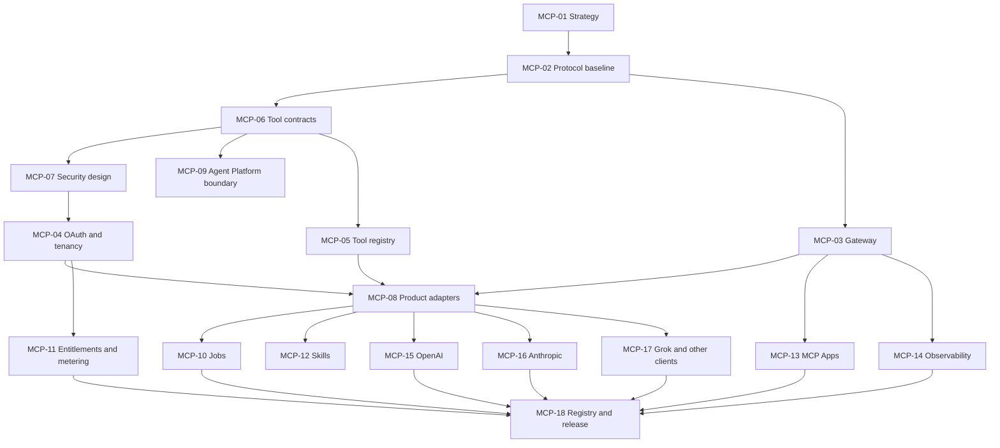

# Tinlance Extensions — Master Delivery Roadmap

**Document status:** Master roadmap baseline — proposed, not yet implemented or verified  
**Owner:** Tinlance Limited  
**Repository:** https://github.com/LloydCoder/tinlance-extensions  
**Last updated:** 2026-11-04

> This roadmap is a controlled delivery plan, not a status report. A phase or work package is complete only when its evidence, acceptance criteria and review record exist. A green build alone does not prove product readiness.

## 1. Delivery strategy

Tinlance Extensions will be delivered through three programme milestones, with security, privacy, testing, documentation and operational readiness as continuous gates.

- **Milestone A — Governed foundation:** repository, architecture, toolchain, CI, identity, policy and core platform contracts.
- **Milestone B — Commercial beta:** initial browser products, product adapters, MCP beta, accounts, entitlements, usage controls and limited distribution.
- **Milestone C — Enterprise production:** browser/client compatibility, independent assurance, resilience, enterprise controls, directory/store approvals and operational acceptance.

The project retains the 25-phase ecosystem roadmap. The MCP programme is a dedicated 18-work-package workstream integrated into those phases. It is not a parallel ungoverned server project.

## 2. Programme-wide release principles

1. No planned product is advertised as available.
2. No MCP tool is published before its backing service and permission model are ready.
3. No consequential browser action is authorized by MCP alone; the Tinlance Agent Platform remains authoritative.
4. No public directory submission is treated as approved until the platform confirms approval.
5. No browser support is claimed without a tested browser/version record.
6. Security and privacy are release gates, not final-phase tasks.
7. Every work package has an owner, dependencies, acceptance evidence and status.
8. Paid infrastructure or vendor commitments require explicit budget approval.
9. Use pull requests, CI evidence and reviewable changes; avoid undocumented direct-to-production edits.
10. The project status must distinguish proposed, in progress, implemented, verified, released and deprecated.

## 2A. Phase 0 — Repository foundation

**Purpose:** establish the minimum governed, testable repository foundation before product implementation.

Scope:
- Repository conventions, ignore rules, security and contribution policies.
- Least-privilege CI workflow with immutable action pins.
- Dependency-free repository validation and regression tests.
- ADRs for repository governance and the proposed MCP protocol baseline.
- Accurate README, architecture, roadmap and implementation-status links.
- Preserve the existing Apache-2.0 license pending a separate legal/IP decision.
- No paid infrastructure, product runtime, browser package, or MCP gateway in this phase.

**Phase 0 exit:** foundation files exist; repository validation and tests pass in GitHub Actions; architecture and roadmap are reconciled; final change is merged to main. This is repository readiness, not application readiness.

## 3. The 25-phase ecosystem roadmap

### Foundation — Milestone A

| Phase | Scope | Exit evidence |
|---:|---|---|
| 01 | Repository and baseline forensic audit | Default branch, files, workflows, dependencies, current product state, risks and gaps documented |
| 02 | Product requirements and portfolio specification | Product briefs, user personas, use cases, permission needs, pricing assumptions and release order |
| 03 | Master architecture and ADR approval | Approved architecture, boundaries, dependency graph, security model and ADR set |
| 04 | Monorepo and developer platform | Reproducible workspace, pinned toolchain, local setup, scripts and clean checkout build |
| 05 | CI/CD and repository governance | Required checks, branch protection, dependency automation, release permissions and provenance controls |
| 06 | Design system and UX foundation | Tokens, components, accessibility baseline, extension patterns and web portal design |
| 07 | Browser SDK and compatibility foundation | Browser adapters, messaging, storage, permissions and compatibility test harness |
| 08 | Identity, authentication and tenancy | Account model, sessions, organization model, tenant isolation and authorization primitives |
| 09 | Backend and data architecture | Service ownership, schemas, migrations, API contracts, queues and data lifecycle |
| 10 | Security and privacy control plane | Threat models, policies, consent, audit, secret handling, retention and security gates |

### Phase 01 — Repository and baseline forensic audit

**Purpose:** establish a dated, commit-specific factual baseline and remediation register for the repository, rather than inferring implementation from product plans.

Scope:
- Inspect default branch contents, history, repository settings available to the audit, license, package manifests, workflows, tests, releases, and current pull requests.
- Record verified facts separately from unavailable/unknown administrative settings.
- Inventory absent runtime components and identify security, privacy, supply-chain, quality, and operational risks.
- Reconcile README, architecture, roadmap, ADRs and actual repository state.
- Add reproducible repository validation so the baseline itself remains regression-tested.

**Phase 01 exit:** baseline report is committed; all accessible evidence is cited or identified; unknowns are explicit; critical/high foundation blockers have an owner and treatment; CI is green and the change is merged. Administrative settings inaccessible to the integration remain owner-verification items and must not be falsely marked complete.

**Milestone A exit:** the architecture and repository are sufficiently defined and reproducible to build products without creating duplicate authority, security or data models. MCP implementation must not begin before the MCP-specific P0 design gates in section 4 are approved.

### Product and commercial beta — Milestone B

| Phase | Scope | Exit evidence |
|---:|---|---|
| 11 | Site Security Auditor | Working passive checks, evidence, confidence labels, safe URL handling and tests |
| 12 | Tinlyt Page Extractor | Reliable extraction, structured outputs, provenance and hostile-content handling |
| 13 | Aithyrex Guard | Local-first sensitive-data inspection, supported AI interfaces, clear user controls |
| 14 | Tinlyt Verify | Claim/evidence workflow, supporting and conflicting sources, uncertainty representation |
| 15 | Tinlyt Monitor | Scheduled monitoring, change detection, job lifecycle, notification and retention controls |
| 16 | FadeReach Prospect Capture | User-selected capture, normalization, lawful-use controls and export |
| 17 | Agent Browser Bridge | Paired browser, scoped actions, Agent Platform authorization, approval, audit and isolation |
| 18 | Commercial platform and customer management | Plans, entitlements, billing integration, usage metering, organization and account controls |
| 19 | Integrations and interoperability | Product adapters, external integrations, MCP beta, developer documentation and compatibility tests |

**Milestone B exit:** the initial portfolio works end-to-end in a controlled beta; MCP is available only for production-backed capabilities; entitlements, authorization, metering and audit are enforced server-side.

### Enterprise production — Milestone C

| Phase | Scope | Exit evidence |
|---:|---|---|
| 20 | Cross-browser compatibility and release engineering | Verified matrix, independent browser packages, store metadata, signing and rollback |
| 21 | Functional, integration and regression verification | Repeatable unit, contract, integration, E2E and cross-client results |
| 22 | Security and supply-chain assurance | Threat-model closure, security testing, SBOM/provenance, pen test and remediation evidence |
| 23 | Reliability and production operations | SLOs, alerting, backup/restore, disaster recovery, incident and capacity evidence |
| 24 | Documentation, legal and compliance readiness | Accurate policies, terms, privacy disclosures, support, admin and developer documentation |
| 25 | Production release and enterprise acceptance | Release approvals, directory/store status, customer acceptance and operational handover |

**Milestone C exit:** production and enterprise claims are supported by independent evidence, tested operational controls and actual platform/store approvals.

## 4. MCP programme — 18 work packages

The MCP workstream is integrated with the 25 phases. It must pass design gates before gateway implementation.

### Gate 0 — Design and authority before MCP implementation

| WP | Work package | Priority | Main dependencies | Acceptance evidence |
|---:|---|---|---|---|
| MCP-01 | MCP product strategy and distribution model | P0 | Phases 01–03 | Approved umbrella/specialist listing strategy, target clients, product scope, ownership and non-goals |
| MCP-02 | Protocol baseline and compatibility strategy | P0 | MCP-01 | Pinned stable specification revision, transport decision, capability matrix, SDK policy and compatibility fallback |
| MCP-06 | Tool contracts, schemas and annotations | P0 | MCP-01, MCP-02, product API contracts | Namespaced tool catalogue, schemas, output contracts, side-effect/risk annotations, version and deprecation rules |
| MCP-07 | Security and authorization enforcement design | P0 | Phases 08–10, MCP-02, MCP-06 | Reviewed OAuth/resource-server design, tenant isolation, scopes, approval matrix, threat model and security tests |
| MCP-09 | Agent Platform and Browser Bridge integration design | P0 | Phase 17 design, MCP-06, MCP-07 | Explicit authority boundary, typed request contract, approval lifecycle and no-bypass test plan |

**Gate 0 exit:** WP-01, WP-02, WP-06, WP-07 and WP-09 are approved. The project has a pinned protocol baseline, approved identity and authorization design, reviewed tool contracts and an explicit Agent Platform boundary. No production MCP gateway work begins before this gate.

### Gate 1 — Core MCP platform

| WP | Work package | Priority | Main dependencies | Acceptance evidence |
|---:|---|---|---|---|
| MCP-03 | MCP gateway and transport | P0 | Gate 0 | Remote endpoint, protocol negotiation, Streamable HTTP, origin validation, bounded requests and conformance tests |
| MCP-04 | OAuth, identity and tenant isolation implementation | P0 | Phase 08, MCP-07 | Login/consent, token validation, tenant-bound context, scopes, revocation and cross-tenant negative tests |
| MCP-05 | Tool and capability registry | P0 | MCP-06 | Registry API, lifecycle state, product ownership, definition fingerprints and reviewed change workflow |
| MCP-08 | Product adapter architecture and first adapters | P0 | Phases 11–16, MCP-03, MCP-05, MCP-06 | Typed adapters to at least one production-backed product, validation, redaction and adapter contract tests |

**Gate 1 exit:** a secured remote MCP service can expose a narrowly scoped, production-backed read-only capability to a test client, with tenant isolation, tool definition integrity, audit and conformance evidence.

### Gate 2 — Commercial and extended capabilities

| WP | Work package | Priority | Main dependencies | Acceptance evidence |
|---:|---|---|---|---|
| MCP-10 | Job management and long-running operations | P1 | Worker/data architecture, MCP-03 | Submit/status/cancel/result, idempotency, quotas, retries, expiry and interrupted-client recovery |
| MCP-11 | Metering, quotas and entitlements | P1 | Phase 18, MCP-04, MCP-05 | Server-side plan checks, per-tool usage, reconciliation, limits, overage behaviour and billing tests |
| MCP-12 | Skills distribution | P1 | Tool contracts, developer documentation | Versioned skills, supported-client matrix, safe instructions and published examples |
| MCP-13 | MCP Apps and interactive UI | P1 | Design system, MCP-02, security review | Optional interactive experience, CSP/origin/message validation, accessibility and client fallback |
| MCP-14 | Observability, audit and diagnostics | P1 | MCP-03 through MCP-11 | Correlated traces, redacted logs, audit explorer, per-tool health and alert/runbook evidence |

**Gate 2 exit:** asynchronous, commercial and interactive capabilities are independently feature-flagged, metered and tested. Clients without optional feature support retain a safe baseline experience.

### Gate 3 — Client compatibility and distribution

| WP | Work package | Priority | Main dependencies | Acceptance evidence |
|---:|---|---|---|---|
| MCP-15 | OpenAI submission and compatibility | P1 | Gates 1–2, distribution dossier | Real-client tests, reviewer credentials, positive/negative test cases, listing assets, privacy/policy declarations and submission status |
| MCP-16 | Anthropic submission and compatibility | P1 | Gates 1–2, distribution dossier | Claude client tests, connector requirements, tool annotations, test instructions, assets and submission status |
| MCP-17 | Grok and wider MCP client compatibility | P1 | Gates 1–2 | Grok custom connector test, documented provisioning, plus representative Codex/IDE/CLI client compatibility results |
| MCP-18 | Official registry, release and distribution automation | P1 | Stable endpoint, verified domain, release pipeline | Verified namespace, valid registry metadata, automated publish/rollback, version history and listing status tracking |

**Gate 3 exit:** each supported client has a tested compatibility record; each directory or registry has a separate, truthful submission/approval state; release automation is reproducible.

### MCP work package dependency overview

## 5. Initial product portfolio and release order

The canonical portfolio contains 26 distinct extension products. See [PRODUCT-CATALOGUE.md](PRODUCT-CATALOGUE.md) for approved product identities, boundaries, overlap decisions and status rules. Portfolio approval is not a commitment to implement or release all 26 simultaneously.

### Initial commercial release candidates

1. Site Security Auditor.
2. Tinlyt Page Extractor.
3. Aithyrex Guard.
4. Tinlyt Verify.
5. Tinlyt Monitor.
6. FadeReach Prospect Capture.
7. Agent Browser Bridge foundations, with public release only after Agent Platform governance gates pass.

### Later release groups

- Tinlyt Research (including Evidence and Source Inspector capabilities).
- Auctaryn Guard (new portfolio product; requirements and Auctaryn integration gate required).
- ThreatFade LinkShield, PrivacyGuard and DownloadGuard.
- FadeReach CompanyIntel, ContactIntel and Outreach Assistant; CRM is an integration, not a separate extension.
- Tinlance Workflow (including FormPilot capability) and Memory Vault Clipper.
- Developer utilities: JSON Explorer, StackDetect, WebDebugger (including API inspection) and AccessibilityCheck.
- SEO Inspector, SERP Intelligence, ShopIntel, Compliance Assistant and Authorized Security Testing Companion.

Do not expose a product or MCP tool as generally available while it is only a roadmap item, mock, fixture, prototype or unverified integration.

## 6. Distribution workstreams

### 6.1 AI client distribution

Track these as independent distribution targets:

| Target | Route | Release status vocabulary |
|---|---|---|
| ChatGPT | Custom MCP connection and public app directory submission | Not started / testing / submitted / approved / published / suspended |
| Claude | Remote MCP connector and Connectors Directory | Not started / testing / submitted / approved / published / suspended |
| Grok | Custom connector and enterprise provisioning | Not started / testing / provisioned / verified |
| Official MCP Registry | Verified namespace and server metadata | Not started / namespace verified / submitted / published / deprecated |
| Codex, Cursor, VS Code, Claude Code and other clients | Direct MCP compatibility | Not tested / smoke-tested / verified / unsupported |

A platform's custom connector support must not be represented as an official public marketplace listing. Record plan, region, account eligibility and client limitations at the time of testing.

### 6.2 Browser distribution

Separate release pipelines and submission checklists for Chrome Web Store, Firefox Add-ons, Edge Add-ons, Opera Add-ons and Safari. Every extension/browser combination must be marked supported only after packaging, permission, functional, update and review testing.

### 6.3 Tinlance-owned distribution assets

Before public submission, prepare and verify:
- Public product catalogue and accurate availability states.
- Product pages and installation instructions.
- Developer portal and MCP documentation.
- Privacy policy, terms, security disclosure and support contact.
- Verified company and domain identity.
- Brand assets, screenshots and store artwork.
- Status page, changelog and release notes.
- Reviewer accounts, test data and repeatable test scenarios.

## 7. Continuous workstreams

These are not deferred to Phase 22 or 24. They operate throughout all phases:

- **Security:** threat modelling, secure design review, SAST, dependency and secret scanning, DAST, penetration tests and remediation.
- **Privacy:** data mapping, consent, minimization, retention, deletion, export and subprocessor review.
- **Quality:** unit, contract, integration, E2E, browser compatibility, accessibility, performance and resilience.
- **Operations:** logs, metrics, traces, alerting, incident response, backups, restore, rollback and cost controls.
- **Documentation:** architecture, ADRs, runbooks, API/MCP docs, store disclosures and migration guides.
- **Commercial:** pricing validation, support process, entitlement accuracy, metering reconciliation and customer feedback.
- **Supply chain:** dependency pinning, lockfile integrity, SBOM, build provenance and release signing.

## 8. Definition of done

A work package is complete only when all applicable conditions are satisfied:

1. Scope and acceptance criteria are met.
2. Code/docs are committed through a reviewable change.
3. Automated tests pass in CI.
4. Security and privacy impacts are reviewed.
5. Contracts and documentation are updated.
6. Observability and failure handling are present where relevant.
7. Evidence links and test results are recorded.
8. No unresolved critical/high release blocker remains.
9. A named owner accepts operational responsibility.
10. Status is updated accurately.

### Enterprise production acceptance

- Fresh checkout installs, builds and tests reproducibly.
- Required CI checks are green on the release commit.
- Initial extensions work and can be released independently.
- Browser compatibility matrix is backed by test evidence.
- Safari has a distinct packaging and release process.
- MCP protocol, OAuth, tenancy, tool registry and client compatibility are verified.
- No unresolved critical/high security issues.
- Tool changes are versioned and security-reviewed.
- Consequential actions require Agent Platform authorization and approvals.
- Usage metering, quotas and entitlement enforcement are tested.
- Privacy disclosures, consent, retention, export and deletion are tested.
- Organization management, roles, audit and enterprise controls work as advertised.
- Backup/restore, rollback, incident response and SLOs are demonstrated.
- Accessibility target is WCAG 2.2 AA for owned web experiences, with documented exceptions and manual review.
- Directory and browser-store approval states are accurately represented.
- Support, vulnerability disclosure and release/update processes are operational.

## 9. Status tracking template

Use this table in project tracking; do not mark a package complete without evidence.

| ID | Status | Owner | Dependencies | Evidence / PR / test run | Blockers |
|---|---|---|---|---|---|
| MCP-01 | Not started | TBD | Phase 01–03 | TBD | TBD |
| MCP-02 | Not started | TBD | MCP-01 | TBD | TBD |
| MCP-03 | Not started | TBD | Gate 0 | TBD | TBD |
| MCP-04 | Not started | TBD | MCP-07, Phase 08 | TBD | TBD |
| MCP-05 | Not started | TBD | MCP-06 | TBD | TBD |
| MCP-06 | Not started | TBD | MCP-01, MCP-02 | TBD | TBD |
| MCP-07 | Not started | TBD | Phase 08–10 | TBD | TBD |
| MCP-08 | Not started | TBD | MCP-03, MCP-05, MCP-06 | TBD | TBD |
| MCP-09 | Not started | TBD | MCP-06, MCP-07, Phase 17 | TBD | TBD |
| MCP-10 | Not started | TBD | Worker architecture | TBD | TBD |
| MCP-11 | Not started | TBD | Phase 18, MCP-04 | TBD | TBD |
| MCP-12 | Not started | TBD | MCP-06 | TBD | TBD |
| MCP-13 | Not started | TBD | MCP-02, design/security | TBD | TBD |
| MCP-14 | Not started | TBD | MCP-03–11 | TBD | TBD |
| MCP-15 | Not started | TBD | Gate 1–2 | TBD | TBD |
| MCP-16 | Not started | TBD | Gate 1–2 | TBD | TBD |
| MCP-17 | Not started | TBD | Gate 1–2 | TBD | TBD |
| MCP-18 | Not started | TBD | Stable endpoint, verified domain | TBD | TBD |

## 10. Immediate next actions

1. Complete Phase 01 against the actual repository state; the README alone is not proof of the proposed scaffold.
2. Review and approve this architecture and roadmap.
3. Create the remaining ADRs and detailed product requirements.
4. Validate the monorepo toolchain and browser framework with a minimal spike.
5. Define the first product API contracts and the MCP protocol baseline.
6. Complete MCP Gate 0 before implementing the gateway.
7. Do not provision paid infrastructure or submit public listings until the corresponding cost and readiness gates are approved.

**Current status:** The roadmap is documented as a proposal. No phase or MCP work package is marked implemented, tested, submitted, approved or released by virtue of this document.
