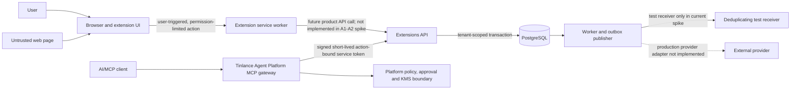

# Tinlance Extensions — Security Data-Flow Inventory and Threat Model

**Status:** A4 baseline draft; product-specific owner review, privacy/legal review and implementation verification are outstanding.
**Date:** 2026-11-08
**Owner:** Tinlance Limited
**Scope:** Current A1–A3 feasibility spikes, the shared Extensions architecture, and the first seven portfolio candidates.
**Normative references:** [System architecture](SYSTEM-ARCHITECTURE.md), [26-product catalogue](PRODUCT-CATALOGUE.md), [Phase 02 requirements](PHASE-02-PRODUCT-REQUIREMENTS.md), [A3 API spike](../spikes/architecture-feasibility/a3-backend-api/README.md).

> This is an evidence-backed threat-model baseline and a gap register. It is not a completed product-specific privacy assessment, DPIA, legal opinion, penetration test, security certification, or release approval. Unknown data paths are explicitly marked unknown rather than assumed safe.

## 1. Executive disposition

A1–A3 now provide executable evidence for a minimal browser-permission spike, PostgreSQL tenant isolation and job/outbox processing, an API-to-PostgreSQL adapter, and code-level Platform authorization. The current repository does **not** contain the production extension suite or production provider integrations. Therefore, most first-seven product data flows are still design-level.

The highest-impact A4 risks are:

1. **Unspecified product data paths:** exact local/cloud processing, third-party processors, retention and deletion behaviour are not approved for each product.
2. **Unclassified business payload schemas:** PR #116 now constrains A3 `tenant_records.payload`, `jobs.payload` and `outbox_events.payload` to JSON objects no larger than 1 MiB; the consumer inbox already has the same bound. This limits resource consumption and malformed payload shapes, but does not establish product-specific field allowlists, sensitivity classification, retention or deletion.
3. **External delivery boundary:** A3 now has a generic HMAC-signed, host-allowlisted HTTPS webhook adapter with event-ID idempotency headers and bounded payload/time. No production provider configuration, receiver-side replay-window enforcement, provider-side duplicate-effect guarantee, transfer assessment or live delivery is evidenced.
4. **Operational data lifecycle:** no production retention scheduler, verifiable export/deletion workflow, backup retention policy or cross-region restore proof is evidenced.
5. **Browser and AI content trust:** page content, URLs, AI prompts/responses and tool outputs must remain untrusted data and must never become authorization instructions.

**A4 is not passed.** This document makes the remaining decisions and evidence requirements explicit.

## 2. System boundary and trust zones

The architecture has separate browser-distribution and AI/MCP integration surfaces. The Tinlance Agent Platform remains the authority for consequential execution and approvals; the Extensions MCP/API layer is an adapter, not an alternate policy authority.

### Trust boundaries

| Boundary | Untrusted input | Authority that must be enforced | Current evidence / gap |
|---|---|---|---|
| Web page → extension | DOM, URL, title, links, downloaded content, page messages | User gesture, narrow browser permission, schema validation; page content is never policy | A1–A2 proves minimal user-triggered `activeTab` and `activeTab+scripting` fixtures. No product content-script system exists yet. |
| Extension → product API | Client-supplied IDs, content, auth state, action requests | Server-side identity/tenant derivation, entitlement and product authorization | Production product APIs are not implemented. |
| MCP client → Platform | Tool arguments, resource IDs, client metadata | Platform authentication, policy, approval and capability checks | Platform integration is code-level; live identity/KMS configuration is not evidenced. |
| Platform → Extensions API | Signed delegated JWT, action/resource, idempotency key | Signature, issuer, audience, client, tenant, scope and action-bound purpose | Issuer and receiver code are merged and tested; live KMS/JWKS and deployment remain open. |
| API → PostgreSQL | SQL parameters, tenant context, bounded JSON object payloads | Least-privilege role, transaction-local tenant context, RLS, 1 MiB object constraints and audit | PostgreSQL 16 integration tests cover tenant isolation, session reset, cancellation, replay and payload-boundary rejection. |
| Publisher → external provider | Event payload (≤1 MiB), signing secret, event UUID idempotency key | Exact hostname allowlist, HTTPS, HMAC-SHA256, bounded timeout, redirect denial, secret isolation, egress control and receiver-side idempotency/replay-window checks | Generic signed webhook adapter is tested; no production provider/receiver or live delivery is configured. |
| Operations → logs/backups | Identifiers, error details, event metadata, database snapshots | Redaction, access control, retention, deletion, encryption and recovery policy | Production telemetry and lifecycle controls remain unimplemented/unverified. |

## 3. Data classification

Use these classes as the minimum classification vocabulary. Product owners must refine the classification and lawful basis for their actual use cases.

| Class | Examples | Minimum handling |
|---|---|---|
| C0 — Public | Public URLs, public page metadata, public company information | Collect only for a documented feature; preserve source and retrieval context; do not assume public means unrestricted reuse. |
| C1 — Internal operational | Tenant IDs, job IDs, event IDs, status, timestamps, non-sensitive error codes | Tenant-scope, access-control, bounded retention and audit. |
| C2 — Personal / user content | User-selected page text, names, business contact details, claims, notes, snapshots | Purpose limitation, minimization, explicit product disclosure, access control, retention/deletion and lawful-use review. |
| C3 — Sensitive / secret | Credentials, API keys, session tokens, confidential source code, sensitive prompts, regulated or special-category data | Do not collect by default; local-first where approved; never place in ordinary telemetry; encrypt and tightly restrict if processing is explicitly approved. |
| C4 — Security authority | OAuth tokens, service JWTs, KMS key material, approval evidence, provider secrets | Never log raw values; use managed secret/KMS boundaries, short TTL, rotation/revocation and privileged access audit. |

**Default:** raw page content, prompts, responses, credentials and provider secrets are not telemetry. Any exception requires an explicit product decision and privacy/security review.

## 4. Implemented A1–A3 data-flow inventory

| Component | Data entering | Data persisted or emitted | Verified boundary | Remaining lifecycle gap |
|---|---|---|---|---|
| A1–A2 read-only browser fixture | Active tab after user opens the extension action | Tab title/origin are read in the fixture; no product backend is implemented | `activeTab` only; no persistent host permission | Product-level consent, local storage, export/deletion and telemetry decisions are not applicable/implemented in the spike. |
| A1–A2 permission-sensitive fixture | Active tab after an explicit visible-button or keyboard action | Fixed packaged script reads title/origin in the fixture | `activeTab+scripting`; no broad host permission | This is not evidence for any of the 26 product permission sets. |
| Safari package fixture | Read-only Safari MV2 manifest and packaged extension resources | Xcode app/appex build output | Manifest/package checks only | Safari runtime, signing, notarization and distribution review remain open. |
| A3 API authentication | Bearer JWT claims: issuer, audience, client, subject, tenant, scope, request ID and signed action purpose | Verified principal and request correlation; raw bearer token must not be persisted | RS256/JWKS verification; action purpose binds tenant, subject, tool, resource and replay idempotency key | Live issuer onboarding, KMS key lifecycle, JWKS hosting, revocation and secret rotation remain open. |
| A3 job API | Job ID, tenant derived from verified principal, actor and request ID | `jobs` rows contain job type, status, idempotency key and JSONB object payload capped at 1 MiB | Tenant RLS, transaction-local tenant context, payload constraint and cancellation audit | Product field allowlist/classification, retention, deletion and export are undefined. |
| A3 outbox publisher | Tenant-bound event ID, aggregate ID, event type and JSONB object payload capped at 1 MiB | Outbox attempts, lease state, error code, publication/dead-letter state | Lease token/fencing, tenant isolation, bounded retry and signed webhook transport tests | No production provider; product field minimization, external transfer, receiver idempotency/replay-window and operational replay controls remain open. |
| A3 consumer inbox | Consumer name, event ID and JSONB payload | Tenant-scoped inbox receipt, maximum 1 MiB JSON object | Composite idempotency key and payload-mismatch rejection | No production consumer or business-effect transaction has been approved; receiver-side retention/deletion remains open. |
| A3 audit records | Actor ID, request ID, job/event ID and prior state | Cancellation and replay audit metadata | Tenant-scoped uniqueness, format checks and RLS | Retention schedule, export, legal hold, deletion exception policy and tamper-evidence beyond database permissions remain open. |
| Agent Platform delegated call | User/tenant identity, capability, resource ID, replay idempotency key and approval context | Short-lived signed JWT with action-bound purpose; no inbound bearer forwarding | Platform token issuer and Extensions receiver have matching cross-service test vectors | Production KMS/JWKS, durable approval/idempotency service, deployment and live connectivity remain open. |

### A3 database payload warning — updated after PR #116

The schema now requires `tenant_records.payload`, `jobs.payload` and `outbox_events.payload` to be JSON objects whose serialized JSON size is at most 1 MiB. Migration `012_payload_bounds.sql` validates existing rows before the constraints become active. The consumer inbox and signed webhook adapter also enforce a 1 MiB bound.

This is a structural/resource bound, not a product privacy policy. Until product-specific schemas are approved:

- Treat all payloads as **C2 by default**, and **C3 if a product can include credentials, prompts, source code or other sensitive content**.
- Do not copy raw payloads into logs, traces, error messages or analytics.
- Do not send payloads to an external provider until the product data flow, provider and transfer are approved.
- Before production, define per-event field allowlists, sensitivity classification, redaction, retention and deletion behaviour.

## 5. First-seven product data-flow register

The catalogue establishes the user job and broad input category. It does not establish final local/cloud processing, processors, retention or deletion. Those fields remain explicit product-owner decisions.

| Product / phase | Known or implied input from approved scope | Classification to assess | Local/cloud and recipient status | Required threat/privacy decisions |
|---|---|---|---|---|
| EXT-01 Site Security Auditor / Phase 11 | User-selected website/URL, site configuration signals, findings and evidence | C0/C1; C2 if authenticated or user-specific site data is accessed | Fetching architecture and recipients not approved | SSRF, DNS rebinding, redirect policy, authentication handling, source terms, evidence retention and deletion. |
| EXT-09 Tinlyt Page Extractor / Phase 12 | Current user-selected page and structured extracted content | C0–C3 depending on page content | Local/cloud processing and persistence not approved | User gesture, page-origin isolation, content minimization, extraction provenance, prompt injection, export/deletion and no content telemetry by default. |
| EXT-02 Aithyrex Guard / Phase 13 | Supported AI interaction inputs/outputs; potentially PII, credentials, confidential text and source code | C3 potential | Local-first inspection is a stated direction; exact model, provider and data-egress path are not approved | Local processing boundary, redaction before submission, supported-site coverage, false positives/negatives, user override, incident handling and zero-content telemetry by default. |
| EXT-10 Tinlyt Verify / Phase 14 | User claims, source URLs, supporting/conflicting evidence and notes | C0–C2 | Source retrieval, evidence storage and AI/provider recipients not approved | Source terms, provenance, uncertainty, evidence retention, data minimization, deletion and provider disclosures. |
| EXT-11 Tinlyt Monitor / Phase 15 | User-selected URLs, scheduled fetches, snapshots/diffs and notifications | C0–C2 | Scheduling/storage/notification providers not approved | SSRF, DNS/IP validation, redirects, robots/terms, authenticated pages, secrets, snapshot minimization, retention/deletion and notification leakage. |
| EXT-13 FadeReach Prospect Capture / Phase 16 | User-selected prospect/business-page details and source provenance | C2 personal/business contact data | Enrichment/CRM recipients and transfers not approved | Source rights, lawful basis, purpose compatibility, suppression/deletion, data accuracy, regional transfer, retention and no autonomous outreach. |
| EXT-17 Agent Browser Bridge / Phase 17 | User-selected page context, typed action requests, browser state and approval/correlation metadata | C1–C4 depending on browser context and action | Browser/Platform boundary defined conceptually; production transport and persistence not deployed | Prompt injection, confused deputy, least privilege, action-bound approvals, token isolation, sandboxing, user confirmation, audit and revocation. |

No row in this table is a completed product privacy assessment. Product owners must replace the unknowns with approved, testable decisions before the relevant implementation phase.

## 6. Threat register (STRIDE-oriented)

| ID | Threat / abuse case | Affected assets | Required controls | Current evidence | Residual status |
|---|---|---|---|---|---|
| T-01 | Malicious page content or prompt injection attempts to issue instructions to the extension or agent | Page content, prompts, action requests | Treat page/tool content as untrusted data; strict schemas; no authority from content; Platform policy/approval for consequential actions | Architecture boundary documented; no product content-script implementation | Open per product |
| T-02 | Overbroad browser permissions expose unrelated sites or sensitive browser data | Browser profile, cookies, history, page content | Least privilege, optional permissions at point of use, no remote executable code, manifest regression tests | A1–A2 exact permission tests for minimal fixtures | Open per product |
| T-03 | Spoofed content-script/runtime messages or confused-deputy requests | Extension worker, privileged APIs | Sender/origin validation, message schema, nonce/correlation, allowlisted operations, user gesture checks | No shared production messaging layer yet | Open |
| T-04 | Stolen/replayed delegated JWT is used against a different resource | Jobs, dead-letter events, tenant actions | Signature/issuer/audience/client/scope checks; short TTL; signed action-bound purpose; idempotency key; audit | Agent Platform PR #213 + Extensions PR #72; shared vectors and cross-repo tests | Code-level control passed; live KMS/JWKS and revocation open |
| T-05 | Client-supplied tenant ID or pooled-connection state leaks cross-tenant rows | Tenant records, jobs, outbox, inbox, audit | Derive tenant from verified principal; transaction-local context; RLS/FORCE RLS; connection reset/disposal | PostgreSQL 16 integration tests, including pooled-session reset and tenant isolation | Production deployment/configuration open |
| T-06 | Duplicate delivery causes duplicate external side effects after crash/retry | Outbox events and provider effects | Provider idempotency keys, receiver inbox, transactional business effect, explicit delivery semantics and replay audit | Test receiver proves deduplicated local database effect under shared transaction | Production provider semantics open |
| T-07 | User-selected URL enables SSRF, DNS rebinding or access to metadata/private networks | Internal services, cloud metadata, credentials | HTTPS policy, IP range blocking, DNS pin/revalidation, redirect denial/revalidation, egress allowlists, response limits, timeout and content-type limits | No production fetch service in current spike | Open before URL-fetching products |
| T-08 | Payloads, prompts or secrets leak through logs, traces or exception details | C2/C3 content, credentials, tokens | Structured allowlisted logging, secret/token redaction, no raw content telemetry, access and retention policy | No production telemetry implementation/evidence | Open |
| T-09 | Excessive retention or incomplete deletion leaves user data in snapshots, inboxes, logs or backups | User content, prospect data, audit records | Per-product retention schedule, deletion propagation, backup expiry, legal-hold exceptions, verifiable deletion evidence | No production retention/deletion workflow | Open |
| T-10 | Provider or source terms do not permit collection, storage or onward transfer | Prospect data, page content, search/commerce data | Source inventory, terms/licensing review, lawful-basis review, purpose limitation and suppression | Requirements identify legal/provider gates; no provider approval evidenced | Open |
| T-11 | Compromised dependency or build pipeline changes extension/runtime code | Extension packages, release artifacts, signing keys | Lockfile, provenance, SBOM, pinned actions, dependency review, signed releases, protected branch and required checks | CI and supply-chain workflows exist; Extensions main is currently unprotected | Open governance/release gate |
| T-12 | Tenant or actor data is exposed through audit/event identifiers or replay errors | Audit records, event metadata | Tenant scoping, bounded identifiers, non-enumerating errors, redacted diagnostics | RLS, bounded request IDs, action-bound purpose and integration tests | Production monitoring/retention open |
| T-13 | OAuth/KMS/provider secret compromise enables unauthorized service actions | Identity, tenant authority, provider accounts | Managed KMS/secrets, audience/scope/purpose binding, rotation, revocation, no inbound token forwarding | Code-level signed token path exists; live keys and secret operations absent | Open |
| T-14 | Backup restore reintroduces deleted data or violates residency/retention | Database snapshots, backups | Backup classification, encryption, region constraints, retention, restore-time deletion replay and tested RPO/RTO | Single-cluster logical restore evidence only | Open |

## 7. Required privacy and data-lifecycle controls

Before a product can pass A4, its owner must approve:

1. **Purpose and minimization:** exact user job, necessary fields, collection trigger and prohibited data.
2. **Processing location:** local-only, first-party cloud, or named third-party processor; no vague “AI processing” description.
3. **Consent and controls:** user notice, point-of-use permission, revoke/disconnect, export and deletion controls.
4. **Retention:** separate periods for raw content, derived findings, metadata, audit records, telemetry, inbox/outbox records and backups.
5. **Deletion:** user-level and tenant-level deletion, propagation to derived data/processors, retry handling and verifiable evidence; legal/audit retention exceptions must be documented.
6. **Processors and transfers:** provider identity, data location, subprocessors, contract/DPA status, international transfers and source terms.
7. **Telemetry:** allowlisted fields, redaction tests, access controls and retention; no raw page content, prompts or secrets by default.
8. **Security testing:** cross-tenant, permission, injection, replay, SSRF, export/deletion and failure-path tests appropriate to the product.
9. **Incident response:** owner, severity, containment, customer notification and recovery responsibilities.

### Minimum deletion test contract

A product-specific integration test must prove that a test subject's data is removed from all in-scope primary stores and derived stores, while explicitly enumerating any records retained for security/legal obligations. The test must include retries, partial failure and a post-deletion read proving absence. Backup expiry and restore-time deletion replay require a separate operational test; deleting the live row alone is not proof of backup erasure.

## 8. A4 acceptance gates

A4 may be considered complete only when all applicable gates below have evidence:

| Gate | Required evidence | Current status |
|---|---|---|
| A4.1 Platform data inventory | Complete source/purpose/recipient/storage/retention map for each implemented platform flow | Partial: A1–A3 inventory drafted; production services absent |
| A4.2 First-seven product flows | Product-owner-approved data-flow record for each first-seven product | Open |
| A4.3 Product threat models | Product-specific assets, trust boundaries, abuse cases, mitigations, residual risk and owner sign-off | Open |
| A4.4 Privacy controls | Local/cloud decision, consent, retention, export/deletion, processor/transfer and telemetry policy | Open |
| A4.5 Executable privacy tests | Redaction, retention, deletion, export, tenant isolation and failure-path tests | Open |
| A4.6 External review | Legal/provider/source-rights and security review where applicable | Open |
| A4.7 Release decision | No unresolved critical/high findings; owner accepts residual risk and records go/no-go | Open |

## 9. Decisions that must not be inferred

The following cannot be settled from the repository alone:

- Whether any product may send page content, prompts, source code or personal data to an external AI/provider.
- Which legal basis, consent model, processor contracts and transfer mechanisms apply to each target market.
- Product-specific retention periods and audit/legal-hold exceptions.
- Which sources/providers may be used for prospect, SERP, commerce or download intelligence.
- Whether users can delete every category of data or whether a defined security/legal audit subset must remain.
- Whether the company accepts a given residual risk or approves a product for release.

These require the accountable product owner and appropriate legal/security review. Do not replace missing decisions with generic defaults.

## 10. Evidence and change control

- [Canonical product catalogue](PRODUCT-CATALOGUE.md)
- [Phase 02 product requirements](PHASE-02-PRODUCT-REQUIREMENTS.md)
- [System architecture](SYSTEM-ARCHITECTURE.md)
- [A1–A2 feasibility README](../spikes/architecture-feasibility/a1-a2/README.md)
- [A3 backend/API feasibility README](../spikes/architecture-feasibility/a3-backend-api/README.md)
- [Phase 02 evidence and feasibility review](PHASE-02-EVIDENCE-AND-FEASIBILITY-REVIEW.md)

Any change to data categories, processing location, permissions, providers, retention, telemetry or consequential action authority must update this register and the affected product threat model before release.
